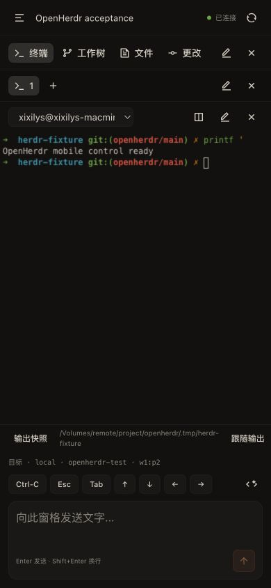

# OpenHerdr

OpenHerdr adds a phone-sized Herdr controller to this OpenChamber checkout. It
shares OpenChamber's components, typography, authored themes and Ghostty terminal
renderer. The original OpenChamber application remains available.

## Start and pair

From the repository root, with the existing dependencies installed:

```sh
bun run build:herdr
node packages/web/bin/openherdr.js start --session default --cf
node packages/web/bin/openherdr.js connect --qr
```

Scan the QR code with the phone camera and confirm the displayed server in the
browser. The one-time link expires after 10 minutes. A paired device can access
the selected Herdr session and its enabled saved SSH machines. Keep pairing links
private. Generate a fresh link for each device.

The local application is at `http://127.0.0.1:4318`. Cloudflare prints its actual
HTTPS URL on startup. Quick Tunnel addresses change after a restart. Browser
credentials belong to that exact origin, so a new address needs a new pairing.
The PWA manifest supports adding the page to the home screen; live data always
requires a connection.

```sh
node packages/web/bin/openherdr.js status
node packages/web/bin/openherdr.js stop
```

Stop closes this bridge and its tunnel. Herdr and its agents keep running.
Separate Herdr sessions need separate `--state-dir` and `--port` values. The CLI
refuses to reuse a running bridge for a different session or inherited socket.

## Herdr plugin

```sh
herdr plugin link /absolute/path/to/openherdr/plugins/openherdr
herdr plugin action invoke start --plugin openherdr
herdr plugin action invoke connect --plugin openherdr
```

The start action creates the bridge and tunnel. Connect opens an overlay pane
with a pairing QR code. The plugin inherits the current Herdr socket. Its actions
also expose status and stop. See [the plugin guide](../../plugins/openherdr/README.md).

## Connections

Cloudflare carries the browser's bearer-authenticated HTTP requests to the
loopback bridge. An SSH-only alternative is available when OpenHerdr already
runs on the target machine:

```sh
node packages/web/bin/openherdr.js ssh --target workstation --port 4318
```

This foreground command forwards local port 4318 to the target's loopback port
4318 using the existing SSH configuration. Run pairing on that target with
`--server http://127.0.0.1:4318`. SSH port forwarding belongs on a computer or a
phone SSH client. Browsers use HTTP/HTTPS.

Inside the app, select an enabled machine saved by `herdr machine add`. This
connects from the bridge host over SSH, with the profile's session and existing
keys. Remote hosts require Python3 and Herdr 0.9.3 protocol 22 on the command PATH
or the remote `HERDR_BIN_PATH`. The bridge validates actual server status before
sending and never guesses another session.

## Features and limits

| Feature | OpenHerdr behavior |
| --- | --- |
| Workspaces and tabs | List, create, rename and close explicit targets |
| Terminal panes | Select, split, rename, close; text input, keys and mobile shortcuts |
| Terminal output | Official read-only frames in Ghostty, text snapshot fallback |
| Agents | Start supported installed CLI agents and prompt a named agent in its pane |
| Machines | Local session and enabled saved SSH profiles |
| Files | Read-only current-pane directory browser and text preview on the bridge host |
| Git | Read-only local branch, status, working diff and staged diff |
| Worktrees | Inspect Herdr's workspace worktrees |
| Device access | One-use pairing, saved servers, client list and revocation |
| Appearance | OpenChamber components, light/dark themes and 15 shared locales |
| Native mobile | Separate Capacitor iOS/Android app with secure credential storage |

Remote file/Git browsing currently returns an explicit unsupported response.
File editing, Git writes, worktree creation, push notifications and a camera
scanner are absent. A phone's system camera can open the browser pairing link.

OpenCode's structured chat, reasoning/tool cards, model and provider settings,
session history, schedules, extension panels and code review remain in the
original OpenChamber app. Herdr's terminal protocol does not provide these as
provider-independent chat data. OpenHerdr does not claim complete feature parity
for arbitrary CLI agents. Electron and VS Code keep their original application;
the dedicated Herdr entrypoint runs in the browser or mobile shell.

If input delivery is uncertain, the app keeps the draft and blocks further
mutations. Check delivery inspects the saved receipt without resending. Inspect
the terminal before acknowledging an unknown result. If a target disappears,
the app disables sending until another target is chosen explicitly.

## Native builds

```sh
bun run mobile:herdr:ios
ANDROID_HOME=/path/to/android-sdk JAVA_HOME=/path/to/jdk21 bun run mobile:herdr:android
```

The iOS artifact is an unsigned Simulator app. Android produces a debug APK.
See [native build instructions](../../packages/mobile/openherdr/README.md) and
[validation](../../packages/mobile/openherdr/VALIDATION.md). Physical phone
installation, release signing and store distribution are separate work.

## Development

The current outcome and remaining checks are in [STATUS.md](STATUS.md).
[OPENHERDR.md](../../OPENHERDR.md) records the project decisions and boundaries.
Server and UI module documentation describe the transport and state behavior.


