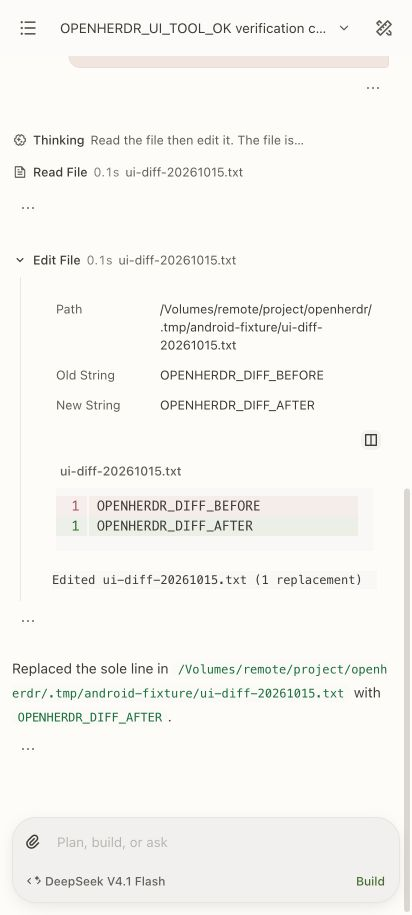
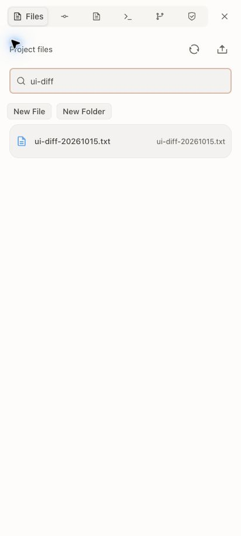
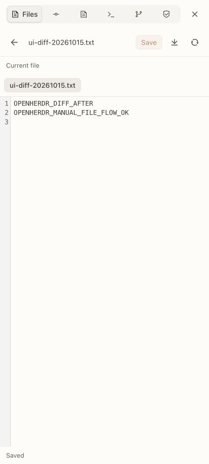
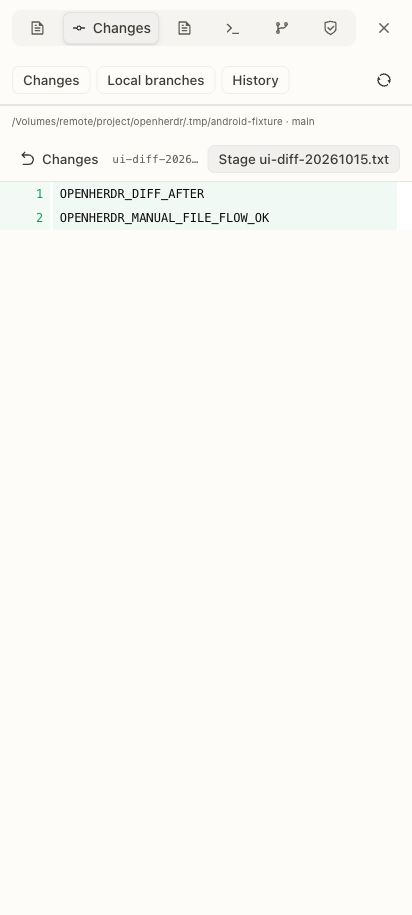
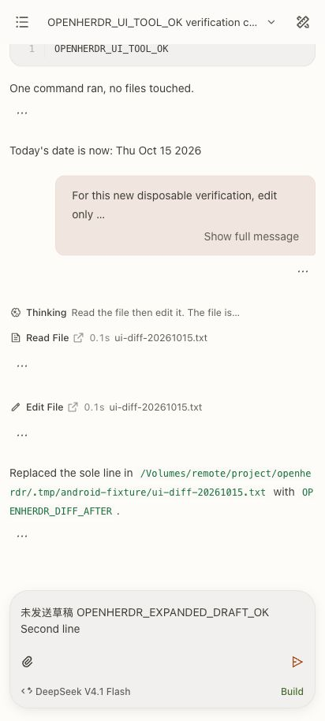
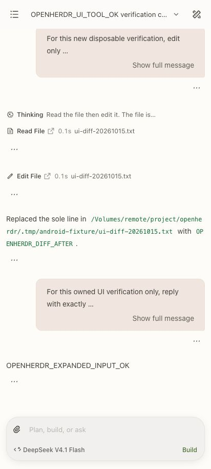

# OpenHerdr

OpenHerdr adds an Android application and authenticated Herdr bridge to this
OpenChamber checkout. It reuses the original mobile header, drawers, editors,
Markdown, diff presentation, typography and themes. The original OpenChamber
application remains available. Current Android validation is recorded in
[STATUS.md](STATUS.md); source implementation and runtime checks are separate.

## Start and pair

From the repository root, with the existing dependencies installed:

```sh
bun run build:herdr
node packages/web/bin/openherdr.js start --session default --cf
node packages/web/bin/openherdr.js connect --qr
```

Scan the QR code with the phone camera and confirm the displayed server in the
browser. The one-time link expires after 10 minutes. A paired device can access
the selected Herdr session and its enabled saved SSH machines. Keep pairing links
private. Generate a fresh link for each device.

The local application is at `http://127.0.0.1:4318`. Cloudflare prints its actual
HTTPS URL on startup. Quick Tunnel addresses change after a restart. Browser
credentials belong to that exact origin, so a new address needs a new pairing.
The PWA manifest supports adding the page to the home screen; live data always
requires a connection.

```sh
node packages/web/bin/openherdr.js status
node packages/web/bin/openherdr.js stop
```

Stop closes this bridge and its tunnel. Herdr and its agents keep running.
Separate Herdr sessions need separate `--state-dir` and `--port` values. The CLI
refuses to reuse a running bridge for a different session or inherited socket.

## Herdr plugin

```sh
herdr plugin link /absolute/path/to/openherdr/plugins/openherdr
herdr plugin action invoke start --plugin openherdr
herdr plugin action invoke connect --plugin openherdr
```

The start action creates the bridge and tunnel. Connect opens an overlay pane
with a pairing QR code. The plugin inherits the current Herdr socket. Its actions
also expose status and stop. See [the plugin guide](../../plugins/openherdr/README.md).

## Connections

Cloudflare carries the browser's bearer-authenticated HTTP requests to the
loopback bridge. An SSH-only alternative is available when OpenHerdr already
runs on the target machine:

```sh
node packages/web/bin/openherdr.js ssh --target workstation --port 4318
```

This foreground command forwards local port 4318 to the target's loopback port
4318 using the existing SSH configuration. Run pairing on that target with
`--server http://127.0.0.1:4318`. SSH port forwarding belongs on a computer or a
phone SSH client. Browsers use HTTP/HTTPS.

Inside the app, select an enabled machine saved by `herdr machine add`. This
connects from the bridge host over SSH, with the profile's session and existing
keys. Remote hosts require Python3 and Herdr 0.9.3 protocol 22 on the command PATH
or the remote `HERDR_BIN_PATH`. The bridge validates actual server status before
sending and never guesses another session.

## Features and limits

| Feature | OpenHerdr behavior |
| --- | --- |
| Workspaces and tabs | List, create, rename and close explicit targets |
| Terminal panes | Select, split, rename, close; text input, keys and mobile shortcuts |
| Terminal output | Official read-only frames in Ghostty, text snapshot fallback |
| Agents | Start supported installed CLI agents and prompt a named agent in its pane |
| Machines | Local session and enabled saved SSH profiles |
| Conversations | Real local OpenCode history, message paging, live events, prompt/abort, model/agent selection, permissions, forms and inline attachments |
| Files | Local/saved-SSH browsing, search, manual editing, create/rename/delete, upload/download, revision conflicts and image/binary preview |
| Git | Local/saved-SSH status, diff, stage/unstage, commit, history and branch/checkout |
| Worktrees | Native Herdr list/create/open/remove, with dirty-removal refusal |
| Device access | One-use pairing, saved servers, client list and revocation |
| Appearance | Original Settings layout, built-in themes/system appearance, fonts/font size, shared profile and per-surface preferences, 15 locales |
| Project context | Notes, Todo and personal plans with persisted edits and conflicts, for native worktrees or an administrator-verified project root |
| Native mobile | Separate Capacitor iOS/Android app with secure credential storage |

File changes are confined to the selected pane's server-resolved directory.
Manual Save compares the loaded revision. A changed file or directory refuses
the write and preserves edits. Directory removal is empty-only. Git requires
the repository root, rejects executable filters and does not provide network
operations, stash, merge/rebase or hunk mutations in the current increment.

Existing native OpenCode sessions are read-only when their identity can be
verified. Writable OpenHerdr conversations have their own native ownership
marker and never take over an existing TUI. Their saved history survives pane
closure; controlling it from a new matching directory requires explicit rebind.
Remote structured conversations and Codex/Claude transcript adapters remain
unfinished. Other CLI agents retain real terminal control. Native reasoning,
tool results and usage are shown only when supplied by the selected source.
Tool details share the original shell and multi-file diff views. Attachments
support inline previews and explicit reads of current project files; the latter
are labelled as current content. Stepped forms keep page-lifetime drafts across
conversation changes and retain them after failed or unknown replies.

Tapping the mobile input now expands the original floating CodeMirror editor.
It shares the original editor shell, viewport pinning and box frame with
OpenChamber. Unicode multiline drafts survive model-picker close,
collapse/reopen and a visit to Files. Mobile Enter inserts a newline. Drafts,
attachments, send/queue eligibility and unknown-delivery locks keep their real
conversation owner.

The actual HTTPS browser at 412×915 passed those interactions and preserved a
non-bottom reading position through the Files round trip. One bounded real
prompt returned `OPENHERDR_EXPANDED_INPUT_OK` exactly once and cleared the sent
draft. Arabic inspection confirmed mirrored model/agent controls; the browser
was then restored to English with the test draft cleared. The receipt is
`.tmp/expanded-composer-browser.json`. Physical native IME, system Back, sharing,
fullscreen input and autocomplete remain unverified or unfinished.

Tool file actions now open the shared original mobile Files browser and existing
host editor with a captured conversation identity and canonical root. The editor
labels the loaded bytes as the current file. A changed pane identity or root
refuses navigation; it preserves existing drafts. Manual Save retains revision
checks and Changes shows a new untracked text file as an added-file diff.

The actual HTTPS browser flow at 412×915 passed current-file opening from a real
tool result, draft retention while closing/reopening the workspace, browsing and
search, manual Save with disk readback, Changes and return to the same chat.
The chat title, unsent composer draft and reader position survived. A separate
owned saved-WSL fixture verified untracked status, the unstaged new-file patch,
an empty staged diff and unchanged readback; its workspace and marked temporary
directory were cleaned up. These results are recorded in
`.tmp/file-navigation-browser-validation.json`, `.tmp/file-flow-browser-state.json`
and `.tmp/untracked-ssh-acceptance.json`.

The latest Android debug APK is 15,738,094 bytes and includes
`herdr-CF2mEnjj.js`, with its bundled HTML matching the web build. It has not been
installed or tested interactively on Android. Older native Connect/cold-start
observations belong to `herdr-BEKetIzv.js`; the previous file-navigation APK used
`herdr-BDGqP9Kp.js`. Complete editor/Git behavior, connected native interaction
and full original-feature parity remain unfinished. The earlier browser download
completion is still unknown. Build details and the isolated Gradle recovery are
recorded in [native validation](../../packages/mobile/openherdr/VALIDATION.md).

Ordinary workspaces need a trusted project-root registration before project context
is available. Pane cwd changes never choose another notes owner. Worktrees of
one repository on the same machine share context; another machine stays separate.
See [the project context contract](../../packages/web/server/herdr/PROJECT_CONTEXT.md).

Provider/MCP/plugin configuration, schedules, agent memory, notifications,
voice, multirun, isolated spaces, extension panels and source-control review
remain in the complete-replication scope in [the plan](ANDROID_PARITY_PLAN.md).
They are not completed by this increment. Android pairing intake accepts a
precise `openherdr://connect` link and still requires confirmation in the app.
A camera scanner and closed-app push delivery are not configured.

If input delivery is uncertain, the app keeps the draft and blocks further
mutations. Check delivery inspects the saved receipt without resending. Inspect
the affected terminal, files, repository or conversation before acknowledging
an unknown result. If a target disappears,
the app disables sending until another target is chosen explicitly.

## Native builds

```sh
bun run mobile:herdr:ios
ANDROID_HOME=/path/to/android-sdk JAVA_HOME=/path/to/jdk21 bun run mobile:herdr:android
```

The iOS artifact is an unsigned Simulator app. Android produces a debug APK.
See [native build instructions](../../packages/mobile/openherdr/README.md) and
[validation](../../packages/mobile/openherdr/VALIDATION.md). Physical phone
installation, release signing and store distribution are separate work.

## Development

The current outcome and remaining checks are in [STATUS.md](STATUS.md).
[OPENHERDR.md](../../OPENHERDR.md) records the project decisions and boundaries.
Server and UI module documentation describe the transport and state behavior.



The file flow below was captured in the actual mobile-width HTTPS browser. The
browser image shows search results; the editor image shows the saved file.







The expanded input and its real response were captured in the same HTTPS browser.
These images do not establish native Android keyboard or Back behavior.




