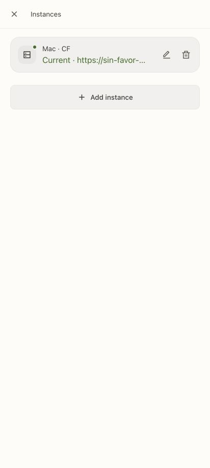
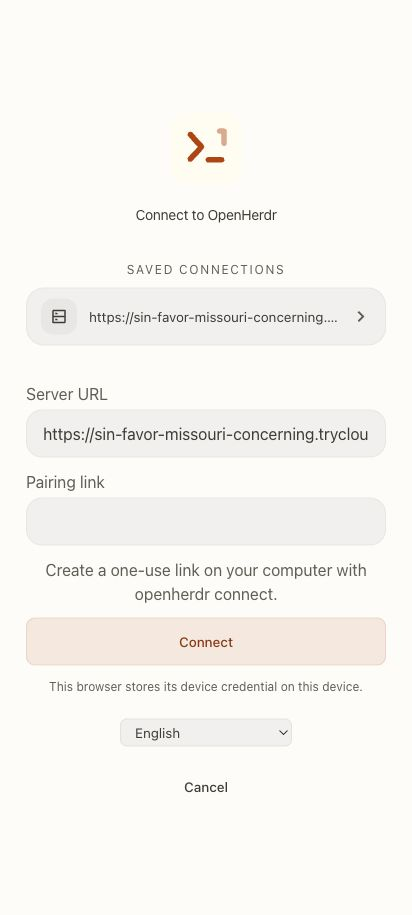
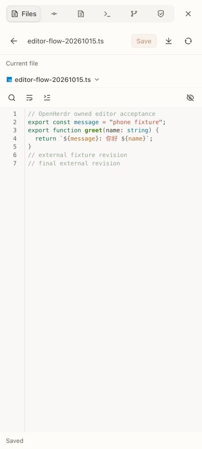
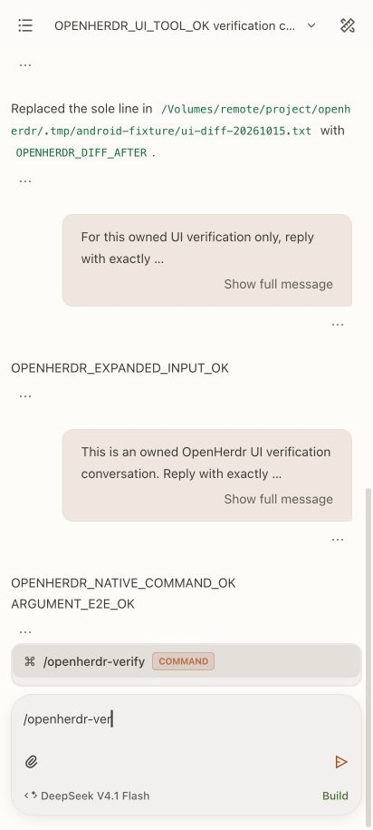
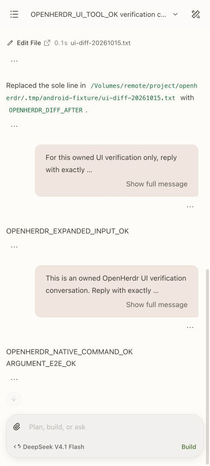

# OpenHerdr

OpenHerdr adds an Android application and authenticated Herdr bridge to this
OpenChamber checkout. It reuses the original mobile header, drawers, editors,
Markdown, diff presentation, typography and themes. The original OpenChamber
application remains available. Current Android validation is recorded in
[STATUS.md](STATUS.md); source implementation and runtime checks are separate.

## Start and pair

From the repository root, with the existing dependencies installed:

```sh
bun run build:herdr
node packages/web/bin/openherdr.js start --session default --cf
node packages/web/bin/openherdr.js connect --qr
```

Scan the QR code with the phone camera and confirm the displayed server in the
browser. The one-time link expires after 10 minutes. A paired device can access
the selected Herdr session and its enabled saved SSH machines. Keep pairing links
private. Generate a fresh link for each device.

The Android app also has an in-app QR scanner. Scanning or opening an
`openherdr://connect` link previews the server and still requires Connect.
The connection screen shares OpenChamber's original Welcome layout and saved
connection rows. Open Instances from the window drawer or Welcome toolbar to
name, switch or remove saved servers. A name edit keeps the current server and
list order. Switching checks that server with its saved credential before
activation; a failed check keeps the current connection. Delete requires a
second confirmation and removes only the local saved entry. Removing the active
entry returns to Welcome; pending delivery records remain available for a later
reconnection. It does not revoke the device on the server.

Open Server URL or Add instance to pair another origin; Cancel returns to the
monitor while the current credential is valid. A saved address is read-only,
and a different address requires its own pairing. A failed device
credential save retains that confirmed connection in memory for a save-only
retry. Android camera and secure-vault relaunch acceptance remain unverified.
The current OpenHerdr iOS SwiftPM project does not include the scanner.





The local application is at `http://127.0.0.1:4318`. Cloudflare prints its actual
HTTPS URL on startup. Quick Tunnel addresses change after a restart. Browser
credentials belong to that exact origin, so a new address needs a new pairing.
The PWA manifest supports adding the page to the home screen; live data always
requires a connection.

```sh
node packages/web/bin/openherdr.js status
node packages/web/bin/openherdr.js stop
```

Stop closes this bridge and its tunnel. Herdr and its agents keep running.
Separate Herdr sessions need separate `--state-dir` and `--port` values. The CLI
refuses to reuse a running bridge for a different session or inherited socket.

## Fixed Cloudflare origin

Use a managed tunnel when the phone should keep the same HTTPS address after
an owned bridge/tunnel restart. The hostname and its ingress must already route
to this bridge's loopback address and port. Configure the account's tunnel,
DNS and ingress separately.

For a remotely managed tunnel, supply its token through an explicit file:

```sh
node packages/web/bin/openherdr.js start --cf --cf-mode managed-remote \
  --server https://herdr.example.com --cf-token-file /private/path/to/tunnel-token
```

For a locally managed tunnel, supply its existing configuration explicitly:

```sh
node packages/web/bin/openherdr.js start --cf --cf-mode managed-local \
  --server https://herdr.example.com --cf-config /private/path/to/cloudflared.yml
```

These modes read the selected files through cloudflared. They do not copy
secrets into an OpenHerdr profile, inspect default Cloudflare/OpenChamber
credentials or modify the input files. `--server` selects the exact HTTPS
origin for pairing; it does not choose or rewrite an ingress rule. Use the same
state directory and named-mode arguments when restarting this instance. Choose
a different `--state-dir` and `--port` to leave an existing bridge running.

`--cf` alone still starts a Quick Tunnel. The original mobile pairing, saved
connection and Monitor flows use either mode's HTTPS origin. The plugin's
Start action retains the Quick default; managed modes are configured through
the CLI in this increment. Named profiles and a tunnel Settings page remain
unfinished.

A successful start confirms the connector's first connection and process
ownership. `status` reports that separately from public routing, which remains
`unverified` in its metadata. Verify the configured HTTPS origin from the phone.
The current process tests cover stable-origin restart and retained/revoked
credentials. Real public Quick access has also passed; actual managed-domain
DNS/ingress and Android use remain unverified in [STATUS.md](STATUS.md).

## Herdr plugin

```sh
herdr plugin link /absolute/path/to/openherdr/plugins/openherdr
herdr plugin action invoke start --plugin openherdr
herdr plugin action invoke connect --plugin openherdr
```

The start action creates the bridge and tunnel. Connect opens an overlay pane
with a pairing QR code. The plugin inherits the current Herdr socket. Its actions
also expose status and stop. See [the plugin guide](../../plugins/openherdr/README.md).

## Connections

Cloudflare carries the browser's bearer-authenticated HTTP requests to the
loopback bridge. An SSH-only alternative is available when OpenHerdr already
runs on the target machine:

```sh
node packages/web/bin/openherdr.js ssh --target workstation --port 4318
```

This foreground command forwards local port 4318 to the target's loopback port
4318 using the existing SSH configuration. Run pairing on that target with
`--server http://127.0.0.1:4318`. SSH port forwarding belongs on a computer or a
phone SSH client. Browsers use HTTP/HTTPS.

Inside the app, select an enabled machine saved by `herdr machine add`. This
connects from the bridge host over SSH, with the profile's session and existing
keys. Remote hosts require Python3 and Herdr 0.9.3 protocol 22 on the command PATH
or the remote `HERDR_BIN_PATH`. The bridge validates actual server status before
sending and never guesses another session.

## View existing windows

The app opens in Monitor. Choose a machine, then an existing workspace, tab and
pane. Agent terminals and ordinary dashboards use the same window list. The
screen comes from that machine's existing Herdr service; a Codex session ID is
not required. Agent state appears only when Herdr reports it.

In the window drawer, enter a name, ID or current directory in Search windows
and press Enter. Results include matching panes in other workspaces on that
machine, with their workspace and tab context. Typing leaves the current results
in place until submission. Clear search returns to the hierarchy. Selecting a
pane returns to Monitor; search and clearing send no terminal input.

Monitor is read-only. Screen observation falls back to the pane's visible text
when the stream is unavailable. Read failures retain the last successful
content and show its time. Switching targets clears the previous target's
content. Reads pause while the app is hidden or offline.

Conversations and terminal controls are separate entries. Select terminal
controls deliberately before sending input or changing a workspace. Existing
agents continue in their current processes.

## Features and limits

| Feature | OpenHerdr behavior |
| --- | --- |
| Window monitoring | Default read-only machine/workspace/tab/pane browser, including ordinary dashboards |
| Workspaces and tabs | List, create, rename and close explicit targets |
| Terminal panes | Select, split, rename, close; text input, keys and mobile shortcuts |
| Terminal output | Official read-only frames in Ghostty, text snapshot fallback |
| Agents | Start supported installed CLI agents and prompt a named agent in its pane |
| Machines | Local session and enabled saved SSH profiles |
| Conversations | Real local OpenCode history, message paging, live events, prompt/abort, model/agent selection, permissions, forms and inline attachments |
| Native slash commands | Original candidate list, scoped live lookup and command/skill/plain submission with attachments and delivery retained |
| Files | Local/saved-SSH browsing, code highlighting, Find/Replace, line navigation, wrapping, full-text code preview, multiple drafts, manual LF/CRLF Save, dirty-file close, create/rename/delete, upload/download, revision conflicts and image/binary preview |
| Git | Local/saved-SSH status, diff, stage/unstage, commit, history and branch/checkout |
| Worktrees | Native Herdr list/create/open/remove, with dirty-removal refusal |
| Device access | One-use pairing, saved servers, client list and revocation |
| Appearance | Original Settings layout, built-in themes/system appearance, fonts/font size, shared profile and per-surface preferences, 15 locales |
| Project context | Notes, Todo and personal plans with persisted edits and conflicts, for native worktrees or an administrator-verified project root |
| Native mobile | Separate Capacitor iOS/Android app with secure credential storage |

File changes are confined to the selected pane's server-resolved directory.
Manual Save compares the loaded revision. A changed file or directory refuses
the write and preserves edits. Directory removal is empty-only. Git requires
the repository root, rejects executable filters and does not provide network
operations, stash, merge/rebase or hunk mutations in the current increment.

Existing native OpenCode sessions are read-only when their identity can be
verified. Writable OpenHerdr conversations have their own native ownership
marker and never take over an existing TUI. Their saved history survives pane
closure; controlling it from a new matching directory requires explicit rebind.
Remote structured conversations and Codex/Claude transcript adapters remain
unfinished. Other CLI agents retain real terminal control. Native reasoning,
tool results and usage are shown only when supplied by the selected source.
Tool details share the original shell and multi-file diff views. Attachments
support inline previews and explicit reads of current project files; the latter
are labelled as current content. Stepped forms keep page-lifetime drafts across
conversation changes and retain them after failed or unknown replies.

Tapping the mobile input now expands the original floating CodeMirror editor.
It shares the original editor shell, viewport pinning and box frame with
OpenChamber. Unicode multiline drafts survive model-picker close,
collapse/reopen and a visit to Files. Mobile Enter inserts a newline. Drafts,
attachments, send/queue eligibility and unknown-delivery locks keep their real
conversation owner.

The actual HTTPS browser at 412×915 passed those interactions and preserved a
non-bottom reading position through the Files round trip. One bounded real
prompt returned `OPENHERDR_EXPANDED_INPUT_OK` exactly once and cleared the sent
draft. Arabic inspection confirmed mirrored model/agent controls; the browser
was then restored to English with the test draft cleared. The receipt is
`.tmp/expanded-composer-browser.json`. Physical native IME, system Back and sharing
remain unverified.

Typing `/` opens the original command list for this conversation's actual
directory. Choosing a command inserts it into the draft; submission reads the
current registry again. Commands take precedence over skills. A skill-name match
attaches its real ID to one prompt with the full original text, files and delivery.
Two successful nonmatches send ordinary text. A failed lookup retains the draft.
Unknown delivery stays locked and is not retried.

The actual 412x915 HTTPS browser selected and executed one harmless fixture
command with an argument. The transcript showed one expanded native template and
one `OPENHERDR_NATIVE_COMMAND_OK ARGUMENT_E2E_OK` reply; the sent draft cleared.
The receipt is `.tmp/slash-browser-validation.json`. The source also shares the
original `$` skill picker and preserves selected native skill IDs through prompt
and command submission. A command with skills admits the original skill context
before executing; a later failure remains an unknown result. Focused tests cover
that order and draft retention. This skill increment has no separate live model
execution acceptance. Agent/file autocomplete and the remaining original editing
actions are unfinished.

Tool file actions now open the shared original mobile Files browser and existing
host editor with a captured conversation identity and canonical root. The editor
labels the loaded bytes as the current file. A changed pane identity or root
refuses navigation; it preserves existing drafts. Manual Save retains revision
checks and Changes shows a new untracked text file as an added-file diff.

The actual HTTPS browser flow at 412×915 passed current-file opening from a real
tool result, draft retention while closing/reopening the workspace, browsing and
search, manual Save with disk readback, Changes and return to the same chat.
The chat title, unsent composer draft and reader position survived. A separate
owned saved-WSL fixture verified untracked status, the unstaged new-file patch,
an empty staged diff and unchanged readback; its workspace and marked temporary
directory were cleaned up. These results are recorded in
`.tmp/file-navigation-browser-validation.json`, `.tmp/file-flow-browser-state.json`
and `.tmp/untracked-ssh-acceptance.json`.

The text/code editor uses the original highlighting, Find/Replace, wrapping,
Go to line and generic code preview. Open files switches between retained drafts;
each row can close its file. Save, Discard and Cancel handle unsaved changes,
including a file that is not currently selected. Manual Save preserves the
detected preferred LF/CRLF style and checks the loaded revision. A failed or
unknown save keeps the document open. Large code previews keep the full file and
render the visible lines through the original virtualizer. Markdown/HTML/JSON
and other specialized artifact previews remain separate unfinished work.



Changes uses the original scrolling file groups, phone diff detail, whitespace
toggle and pinned multiline commit input. Open a working or staged file, return
to the list, stage or unstage explicit paths, then commit the current index.
Navigation and commit text belong to the selected machine, pane terminal and
canonical repository root. Switching targets cannot carry an old diff path into
the new checkout. Failed commits preserve the message; unknown results stay
locked for inspection through the existing delivery controls. Generate, Push and
discard are not available in this host controller. Branches and History keep
their existing entrypoints. Current validation is recorded in [STATUS.md](STATUS.md).

The first physical-device test copy is `openherdr-test1-726029ba6.apk`, stored
locally under `packages/mobile/openherdr/build/` so later debug builds cannot
overwrite it. [Download that first QR-test APK from GitHub](https://github.com/xixilys/openherdr/releases/download/android-test1-726029ba6/openherdr-test1-726029ba6.apk).
The human has requested it for scanning; installation and a camera
result have not been confirmed. [Native validation](../../packages/mobile/openherdr/VALIDATION.md)
records package properties, the latest builds and the separate earlier native
observations. Complete editor/Git behavior, connected native interaction and
full original-feature parity remain unfinished. The earlier browser download
completion is still unknown.

The window monitor passed the actual 412x915 browser flow through Cloudflare
HTTPS on Local, WSL, JP API and Kansas. Existing agent windows and ordinary
Kansas dashboards displayed real output. Reloading the same origin restored
the saved binding without another pairing. The current cold-window increment
also restores the last verified window; actual reloads retained the task overview
and then a manually selected workers window. Screen observation and visible text
remain separate read-only choices. These browser checks do not establish native
Android pairing or lifecycle behavior.




Ordinary workspaces need a trusted project-root registration before project context
is available. Pane cwd changes never choose another notes owner. Worktrees of
one repository on the same machine share context; another machine stays separate.
See [the project context contract](../../packages/web/server/herdr/PROJECT_CONTEXT.md).

Provider/MCP/plugin configuration, schedules, agent memory, notifications,
voice, multirun, isolated spaces, extension panels and source-control review
remain in the complete-replication scope in [the plan](ANDROID_PARITY_PLAN.md).
They are not completed by this increment. Android pairing intake accepts a
precise `openherdr://connect` link and still requires confirmation in the app.
Android includes the QR scanner; physical camera use remains unverified.
Closed-app push delivery is not configured.

If input delivery is uncertain, the app keeps the draft and blocks further
mutations. Check delivery inspects the saved receipt without resending. Inspect
the affected terminal, files, repository or conversation before acknowledging
an unknown result. If a target disappears,
the app disables sending until another target is chosen explicitly.

## Native builds

```sh
bun run mobile:herdr:ios
ANDROID_HOME=/path/to/android-sdk JAVA_HOME=/path/to/jdk21 bun run mobile:herdr:android
```

The iOS artifact is an unsigned Simulator app. Android produces a debug APK.
See [native build instructions](../../packages/mobile/openherdr/README.md) and
[validation](../../packages/mobile/openherdr/VALIDATION.md). Physical phone
installation, release signing and store distribution are separate work.

## Development

The current outcome and remaining checks are in [STATUS.md](STATUS.md).
[OPENHERDR.md](../../OPENHERDR.md) records the project decisions and boundaries.
Server and UI module documentation describe the transport and state behavior.


The file flow below was captured in the actual mobile-width HTTPS browser. The
browser image shows search results; the editor image shows the saved file.


The expanded input and its real response were captured in the same HTTPS browser.
These images do not establish native Android keyboard or Back behavior.


